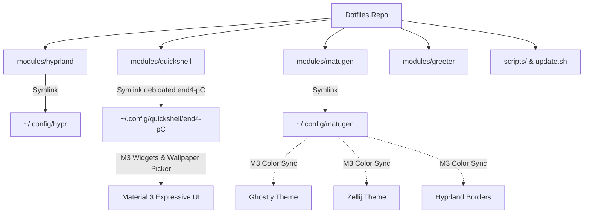

# Kế hoạch chuyển đổi Dotfiles: Umbriel + Noctalia ➔ Hyprland + end4-pC (Material 3 Expressive)

> **Mục tiêu**: Thay thế toàn bộ tầng giao diện cũ (Umbriel compositor + Noctalia shell) bằng giao diện **Material 3 Expressive** của `end4-pC` (Quickshell) + `matugen`, đồng thời:
> 1. **Bảo tồn 100% workflow cá nhân**: Ghostty (không dùng Kitty/Foot), Google Chrome, Nautilus, Herdr, Fcitx5 (Lotus), tần số quét 120Hz native (HDMI-A-1), tốc độ caret 180ms/50Hz.
> 2. **Chuyển toàn bộ phím tắt quen thuộc**: Đấu nối trực tiếp vào các widget Material 3 (Launcher, Clipboard, Overview, Screenshot, Lockscreen).
> 3. **Debloat triệt để**: Cắt bỏ sạch rác i18n thừa, ảnh screenshots, bloatware (Firefox/Kitty/Foot).
> 4. **Self-contained**: Đóng gói trực tiếp vào repo dotfiles (không phụ thuộc mạng khi cài đặt), symlink ra `~/.config/`.
> 5. **Bổ sung `update.sh`**: Script 1 lệnh tự động cập nhật hệ thống, packages và dotfiles.

---

## 🏗️ Kiến trúc tổng thể sau chuyển đổi



---

## 📌 Các giai đoạn thực hiện (Implementation Phases)

### 🌿 Phase 0: Chuẩn bị Branch Git
1. Đảm bảo working tree hiện tại an toàn.
2. Tạo và checkout sang branch tính năng mới theo convention:
   ```bash
   git checkout -b feature/end4-material3-ui
   ```
> [!CAUTION]
> **Tuyệt đối không tự ý chạy `git commit` hay `git push`** trong quá trình agent thực hiện. Chỉ chỉnh sửa file và xuất diff rõ ràng để user/reviewer kiểm tra.

---

### 📦 Phase 1: Chuẩn hóa Package Manifests (`packages/`)
Loại bỏ các gói phụ thuộc của Umbriel/Noctalia và khai báo chính xác các gói cần thiết cho Hyprland + Material 3:

1. **Chỉnh sửa `packages/pacman.txt`**:
   - Thêm vào nhóm desktop:
     ```text
     # Wayland & Hyprland Core
     hyprland
     hypridle
     hyprlock
     hyprsunset
     hyprpicker
     xdg-desktop-portal-hyprland
     qt6-wayland
     qt6-declarative
     qt6-svg
     brightnessctl
     libnotify
     ```
2. **Chỉnh sửa `packages/aur.txt`**:
   - **Xóa bỏ hoàn toàn**:
     ```text
     umbriel-git
     xdg-desktop-portal-umbriel-git
     noctalia-greeter
     ```
   - **Thêm vào**:
     ```text
     matugen-bin
     illogical-impulse-quickshell-git
     hyprshot
     bibata-cursor-theme
     ```

---

### 🧹 Phase 2: Dọn dẹp triệt để Module cũ
Xóa bỏ 100% các file và thư mục của module cũ:
```bash
rm -rf modules/umbriel
rm -rf modules/noctalia
```
Cập nhật danh sách modules trong `install.sh`:
- Trong mảng `DESKTOP_MODULES` và `ALL_MODULES`:
  - Xóa `umbriel` và `noctalia`.
  - Thêm `hyprland`, `quickshell`, `matugen`.

---

### 🖥️ Phase 3: Xây dựng Module `modules/hyprland`

Tạo thư mục: `modules/hyprland/files` và script `modules/hyprland/setup.sh`.

#### 1. Cấu trúc thư mục `modules/hyprland/files/`:
- `hyprland.lua`: File entrypoint chính của Hyprland (load thư viện + gọi `custom/`).
- `hypridle.conf`: Cấu hình idle/tắt màn hình/sleep.
- `hyprlock.conf`: Màn hình khóa Material 3.
- `hyprland/`: Thư viện scripts, lib, services nội bộ của end-4.
- `custom/`: Nơi chứa toàn bộ cấu hình ghi đè workflow cá nhân:
  - `custom/variables.lua`:
    ```lua
    -- Ép cứng ứng dụng mặc định
    terminal = "ghostty"
    browser = "google-chrome-stable"
    fileManager = "nautilus"
    codeEditor = "antigravity"
    hl.env("qsConfig", "end4-pC")
    ```
  - `custom/general.lua`:
    ```lua
    -- Màn hình 1080p @ 120Hz native trên HDMI-A-1
    hl.monitor({
        output = "HDMI-A-1",
        mode = "1920x1080@120",
        position = "0x0",
        scale = 1
    })

    -- Bàn phím & Caret ergonomics
    hl.input({
        repeat_rate = 50,
        repeat_delay = 180,
        kb_layout = "us"
    })
    ```
  - `custom/execs.lua`:
    ```lua
    hl.on("hyprland.start", function ()
        -- Bộ gõ tiếng Việt fcitx5 Lotus
        hl.exec_cmd("fcitx5 -d --replace")
    end)
    ```
  - `custom/keybinds.lua`: **Bê nguyên 100% phím tắt quen thuộc từ `umbriel/keybinds.toml`**:
    ```lua
    -- Terminal & Tools
    hl.bind("SUPER + Return", hl.dsp.exec_cmd("ghostty"))
    hl.bind("SUPER + A", hl.dsp.exec_cmd("ghostty -e herdr"))
    hl.bind("SUPER + B", hl.dsp.exec_cmd("google-chrome-stable"))
    hl.bind("SUPER + E", hl.dsp.exec_cmd("nautilus --new-window"))

    -- Quickshell Material 3 Controls
    hl.bind("SUPER + Space", hl.dsp.global("quickshell:searchToggleRelease"))
    hl.bind("SUPER + D", hl.dsp.global("quickshell:searchToggleRelease"))
    hl.bind("SUPER + V", hl.dsp.global("quickshell:overviewClipboardToggle"))
    hl.bind("SUPER + Tab", hl.dsp.global("quickshell:overviewWorkspacesToggle"))
    hl.bind("SUPER + BackSpace", hl.dsp.exec_cmd("hyprlock"))

    -- Screenshot
    hl.bind("Print", hl.dsp.global("quickshell:regionScreenshot"))
    hl.bind("SUPER + S", hl.dsp.global("quickshell:regionScreenshot"))

    -- Workspace Navigation (J / K)
    hl.bind("SUPER + J", hl.dsp.workspace("m+1"))
    hl.bind("SUPER + K", hl.dsp.workspace("m-1"))
    hl.bind("SUPER + SHIFT + J", hl.dsp.movetoworkspace("m+1"))
    hl.bind("SUPER + SHIFT + K", hl.dsp.movetoworkspace("m-1"))

    -- Window state
    hl.bind("SUPER + SHIFT + Space", hl.dsp.togglefloating())
    hl.bind("SUPER + Q", hl.dsp.closewindow())

    -- Wallpaper & Theme Quick Actions
    hl.bind("CTRL + SUPER + T", hl.dsp.global("quickshell:wallpaperSelectorToggle"))
    hl.bind("CTRL + SUPER + ALT + T", hl.dsp.global("quickshell:wallpaperSelectorRandom"))
    hl.bind("CTRL + SUPER + SHIFT + D", hl.dsp.global("quickshell:toggleLightDark"))
    ```

#### 2. Viết `modules/hyprland/setup.sh`:
- Tạo `~/.config/hypr`.
- Dùng `link_file` và `link_dir` để link sạch sẽ từ repo sang `~/.config/hypr`.

---

### 🎨 Phase 4: Xây dựng Module `modules/quickshell` (Debloated end4-pC)

Tạo thư mục: `modules/quickshell/files/end4-pC` và script `modules/quickshell/setup.sh`.

#### 1. Quy trình Debloat code `end4-pC` trước khi đưa vào repo:
Sao chép từ `~/.config/quickshell/end4-pC` vào `modules/quickshell/files/end4-pC`, sau đó thực hiện lọc bỏ:
- **Xóa rác i18n**: Trong thư mục `translations/`, xóa toàn bộ các ngôn ngữ không dùng (`de_DE`, `es_ES`, `fr_FR`, `he_HE`, `id_ID`, `it_IT`, `ja_JP`, `pt_BR`, `ru_RU`, `tr_TR`, `uk_UA`, `zh_CN`), chỉ giữ lại:
  - `en_US.json`
  - `vi_VN.json`
- **Xóa thư mục ảnh `screenshots/`** (tiết kiệm gần 8MB).
- **Xóa thư mục `tests/`** và các file `README.*.md` phụ.
- **Xóa thư mục `.git/` nội bộ** của end4-pC để repo dotfiles không bị dính submodule rắc rối.

#### 2. Viết `modules/quickshell/setup.sh`:
- Tạo thư mục `~/.config/quickshell`.
- Dùng `link_dir` để liên kết:
  `$MODULE_DIR/files/end4-pC` ➔ `$HOME/.config/quickshell/end4-pC`.
- Thiết lập trạng thái virtualenv python cho quickshell (nếu cần cho lyrics/widgets) tại `~/.local/state/quickshell/.venv`.

---

### 🌈 Phase 5: Xây dựng Module `modules/matugen` (M3 Color Sync)

Tạo thư mục: `modules/matugen/files` và script `modules/matugen/setup.sh`.

1. **`modules/matugen/files/config.toml`**:
   - Cấu hình Matugen tự động lắng nghe sự kiện đổi hình nền từ Quickshell.
   - Định nghĩa các template xuất mã màu:
     - Hyprland borders (`hyprland-colors.conf` hoặc `colors.lua`).
     - **Ghostty**: Xuất palette Material 3 Expressive vào `~/.config/ghostty/themes/matugen` hoặc cập nhật file config của Ghostty.
     - **Zellij**: Xuất theme `matugen.kdl` vào `~/.config/zellij/themes/`.
     - **Fcitx5**: Đồng bộ màu viền candidate window.
2. **`modules/matugen/setup.sh`**:
   - Link `config.toml` và folder `templates/` vào `~/.config/matugen/`.

---

### 🚪 Phase 6: Cập nhật Greeter (`modules/greeter`)

Chuyển đổi session khởi động từ Umbriel sang Hyprland:
1. Mở `modules/greeter/setup.sh`.
2. Trong phần tạo `/etc/greetd/config.toml`:
   - Thay `command = "start-umbriel"` thành:
     ```toml
     [initial_session]
     command = "Hyprland"
     user = "$TARGET_USER"

     [default_session]
     command = "Hyprland"
     user = "$TARGET_USER"
     ```
   - Gỡ bỏ hoàn toàn chuỗi `noctalia-greeter`.

---

### 🔄 Phase 7: Xây dựng Script gốc `./update.sh`

Tạo file mới tại gốc repo: `update.sh` (cấp quyền `chmod +x`):
```bash
#!/usr/bin/env bash
set -euo pipefail

DOTFILES="$(cd "$(dirname "${BASH_SOURCE[0]}")" && pwd)"
SCRIPTS="$DOTFILES/scripts"
source "$SCRIPTS/common.sh"

log "==> Starting Dotfiles & System Update <=="

# 1. Pull latest dotfiles changes if clean
if [[ -d "$DOTFILES/.git" ]]; then
    log "Pulling latest changes from Git..."
    git -C "$DOTFILES" pull --rebase || warn "Git pull encountered issues, continuing..."
fi

# 2. Update System & AUR Packages
log "Updating Pacman & AUR packages..."
bash "$SCRIPTS/packages.sh"

# 3. Update Runtimes (mise) if available
if command_exists mise; then
    log "Updating mise tools and plugins..."
    mise upgrade --yes || true
fi

# 4. Run Doctor Check
log "Running dotfiles health check..."
bash "$SCRIPTS/doctor.sh"

success "==> System & Dotfiles successfully updated! <=="
```

---

### 🩺 Phase 8: Kiểm thử, Review Code & Chuẩn bị Fresh Install

1. **Dry-Run Test**:
   ```bash
   ./install.sh -n -p desktop
   ```
   Xác minh terminal hiển thị đúng: sẽ cài đặt `hyprland`, `quickshell`, `matugen`, không còn `umbriel` hay `noctalia`.
2. **Code Review**:
   - Agent tiến hành xuất toàn bộ `git diff` và file changes để bạn review.
   - Kiểm tra kỹ: không có file rác, không có hardcode đường dẫn người dùng khác ngoài `$HOME`.
3. **Quy trình Fresh Install trên máy mới (Arch Minimal ISO)**:
   Sau khi bạn commit & push branch này lên GitHub, khi cài lại máy mới:
   ```bash
   # 1. Cài git và clone repo dotfiles của bạn
   sudo pacman -S --needed git
   git clone https://github.com/<your-user>/dotfiles.git ~/Workspaces/dotfiles
   cd ~/Workspaces/dotfiles
   git checkout feature/end4-material3-ui

   # 2. Chạy 1 lệnh duy nhất để cài đặt toàn bộ
   ./install.sh -p all
   
   # 3. Khởi động lại máy
   sudo reboot
   ```
   👉 Hệ thống sẽ tự động kéo các gói pacman/aur binary chuẩn, link cấu hình Material 3, gán phím tắt quen thuộc và vào thẳng desktop trong thời gian siêu nhanh (không còn cảnh chờ đợi 60 phút biên dịch).
